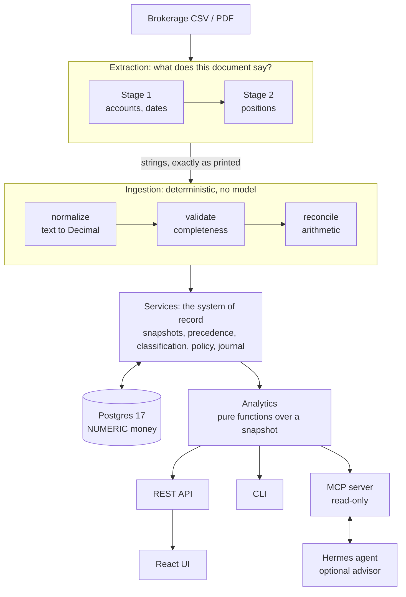

# Hermes Portfolio Manager

A personal portfolio tracker. It reads brokerage CSV exports and PDF statements
with Claude, checks the extracted numbers with deterministic code, and stores
each import as a dated snapshot of your holdings. It reports allocation, tax
placement, gains, and drift from an investment policy you define. An optional
AI advisor, built on the Hermes agent, can read the portfolio and propose
rebalancing trades. It has read-only access to your holdings.

The app and its database run on your own machine, and imported statements are
stored there. When Claude is the extraction provider, each document is sent to
Anthropic's API to be read; the built-in `mock` provider reads CSVs locally and
sends nothing.

## Background

Brokerage exports are inconsistent. Formats differ between institutions and
change without notice, fund names are heavily abbreviated, and `--` is used for
several different kinds of missing value. Some institutions also include
accounts held elsewhere, reported second-hand and sometimes weeks out of date.

A language model handles that variety well, but its output still needs to be
checked before it is stored. The project is split into three layers:

| Layer | Question it answers | How |
|---|---|---|
| **Extraction** | What does this document say? | Claude, behind a replaceable provider interface |
| **Portfolio manager** | What do I hold? | Deterministic parsing, validation and reconciliation |
| **Advisor** *(optional)* | What should I change? | The [Hermes](docs/HERMES_INTEGRATION.md) agent, with read-only access |

All model output goes through validation and reconciliation before anything is
written to the database.

## Data quality

Totals are shown together with the caveats that apply to them: how much of the
value is stale, in accounts whose tax treatment hasn't been confirmed, or
missing a cost basis. Missing values are shown as missing.

This matters in practice. In the portfolio this was developed against, 61% of
the value was in accounts whose as-of date was unknown, and the aggregation feed
reporting them had missed a rebalance. A single total would have hidden that.

## Features

### Importing
- CSV exports and PDF statements are read in two passes: the first finds the
  accounts in the document, the second extracts each account's holdings.
  Fidelity and Vanguard documents are supported and tested; see
  [adding an institution](docs/ADDING_AN_INSTITUTION.md) for others.
- If an account found in the first pass is missing from the second, the import
  is held for review, even when the remaining numbers reconcile.
- Files are deduplicated by content, so importing the same file twice has no
  effect.
- Original files are kept under `data/sources/`, so an import can be re-read if
  extraction improves or a number is questioned.
- An aggregator's export and a direct statement can be imported together. For
  each account, the more authoritative source supplies all of its holdings;
  the two sources are never mixed within one account.
- Accounts reporting no value are listed by name when skipped. Imports that
  fail reconciliation are kept and flagged for review.

### Validation
- Reconciliation checks quantity × price against value, cost basis plus gain
  against value, holdings plus cash against account totals, and account totals
  against the portfolio total. Tolerances are capped, so a large account can't
  absorb a real discrepancy as rounding.
- A missing cost basis stays missing. Gains are reported for the portion of the
  portfolio that has one.
- Money is stored as `Decimal` in Python and `NUMERIC(20,6)` in Postgres, and
  sent as strings in the API.
- Share counts are kept per account and never summed across accounts, because
  the same fund can appear pre-split in one source and post-split in another.

### Analysis
- A dashboard with a value-over-time chart, showing caveats for stale value,
  unconfirmed tax treatment, missing cost basis and incomplete imports.
- Asset allocation and tax placement. Accounts without a confirmed tax
  treatment are excluded from tax analysis.
- Exposure to a single security across all accounts, unrealized gains, cash,
  and comparisons between snapshots. Snapshot comparisons show the change in
  value; they are not investment returns.

### Investment policy and journal
- You write the policy: target weights, drift bands and constraints, in YAML
  with comments. Each save creates a new version, so earlier policies remain
  available.
- Holdings outside their drift band are marked *out of policy*. Results based
  on uncertain data are marked *provisional*; a portfolio can be within its
  bands and still provisional.
- A journal records each recommendation and your decision on it. Deferred items
  stay open, and each decision is added to the item's history.

### AI advisor (optional)
- A chat page where the Hermes agent reads your portfolio, your stated
  investment philosophy, and any views, preferences, web pages or PDFs you add.
  It can research current news and propose trades for each account.
- All figures in a proposal (trade amounts, resulting allocation, estimated
  gains and uninvested cash) are calculated by the app's rebalancing engine.
  When a proposal is saved, the app recalculates it and stores its own figures.
- Trades are expressed in dollars per account and security. Proposals never
  move money between accounts.
- Without a policy or agreed targets, the engine won't produce a proposal, and
  the advisor asks you for targets.

### Command line, agents and operations
- A CLI that covers everything the web UI does.
- An MCP server with 24 tools for AI agents. All are read-only except three
  that record recommendations, decisions and advisor notes. A test and
  `SET TRANSACTION READ ONLY` enforce this.
- Docker Compose, or a macOS login agent that starts the app automatically.
- Backup and restore that keep the database and the original documents
  together in one archive.

### Limitations
The app doesn't place trades or move money; any change the advisor proposes is
yours to carry out. It doesn't fill in missing data with estimates. It is not
investment advice.

## Architecture



The advisor's chat runs in the React UI. The API relays it to Hermes, so the
agent's API key stays on the server.

| Layer | Lives in | What it is responsible for |
|---|---|---|
| **Extraction** | `extraction/` | A vendor-neutral provider interface, versioned prompts, and a strict schema that carries money as **strings**, exactly as printed. Providers: Claude, a deterministic `mock` for tests, and a stub for a local model. A benchmark scores a provider against documents with known-good readings before it can replace another. |
| **Ingestion** | `ingestion/` | The only place text becomes `Decimal`. Detects the document kind, cleans it, checks completeness, reconciles the arithmetic, and matches accounts across sources. No model output is used at this stage. |
| **Services** | `services/` | The system of record: snapshots, which source wins each account, account and security classification, policy versions, the journal, backups. |
| **Analytics** | `analytics/` | Pure functions over a snapshot: allocation, exposure, gains, cash, comparisons, policy drift, and the rebalancing engine. |
| **Interfaces** | `api/`, `cli.py`, `hermes/` | REST for the React UI, a CLI for everything, and an MCP server for agents. All three go through the same services. |
| **Frontend** | `frontend/` | React 19, Tailwind, TanStack Query and Recharts, served by FastAPI from the same origin in production. |

Some design decisions that affect the whole codebase:

- Price is stored on each position, because one document can show two
  different prices for the same symbol.
- A security doesn't need a ticker symbol. 529 plan portfolios often have none,
  so a security is identified by its symbol when present and by its normalized
  name otherwise.
- The as-of date is stored per account. Accounts reported through an
  aggregation feed are only as current as the feed's last sync.
- Security classification returns "unknown" when the name doesn't clearly
  identify an asset class.

More detail, including the full import pipeline, is in
[Architecture](docs/ARCHITECTURE.md) and [Data model](docs/DATA_MODEL.md).

## Quick start

```bash
brew install python@3.12          # macOS; any 3.12+ works
make install                      # venv + dependencies
make dev-db                       # Postgres 17 in Docker, host port 5433
make migrate

portfolio import path/to/export.csv --provider mock
portfolio summary
```

The `mock` provider parses CSVs deterministically and costs nothing. To use
Claude, which you need for PDFs, copy `.env.example` to `.env` and set
`EXTRACTION_PROVIDER=anthropic` and `ANTHROPIC_API_KEY`.

For the web UI:

```bash
make ui-install
make dev                          # API on :8787
make dev-ui                       # UI on :5173, proxying to the API
```

Or run the whole thing in containers:

```bash
docker compose up -d --build      # app on :8787, UI served from the same origin
```

To have it start by itself at login, see
[starting automatically on a Mac](docs/DEPLOYMENT.md#starting-automatically-on-a-mac).
To connect the advisor, see [Hermes integration](docs/HERMES_INTEGRATION.md#setup).

## Documentation

| Document | What it covers |
|---|---|
| [User guide](docs/USER_GUIDE.md) | Importing, reviewing, classifying, policy, the journal, the advisor |
| [Architecture](docs/ARCHITECTURE.md) | How the pieces fit and why they are shaped that way |
| [Data model](docs/DATA_MODEL.md) | The tables, and the constraints that make them trustworthy |
| [GenAI extraction](docs/GENAI_EXTRACTION.md) | The provider boundary, prompts, and the benchmark |
| [Adding a provider](docs/ADDING_A_PROVIDER.md) | Running a local model instead of Claude |
| [Adding an institution](docs/ADDING_AN_INSTITUTION.md) | Supporting a new brokerage |
| [Hermes integration](docs/HERMES_INTEGRATION.md) | The MCP surface, the skill, the advisor, the trigger |
| [Deployment](docs/DEPLOYMENT.md) | Docker, starting at login, volumes, backup and restore |

## Development

```bash
make test lint ui-check benchmark benchmark-check check-secrets
```

About 570 Python tests (unit, plus integration against a real Postgres) and 13
Playwright end-to-end tests. `ruff`, `ruff format`, `mypy --strict`, `tsc` and
`oxlint` all run clean. `benchmark` calls the configured extraction provider,
so with Claude it costs a little money.

The repository contains no real financial data. Test fixtures are anonymized
versions of real exports: they keep the structural quirks (missing tickers,
`--` placeholders, prices that differ between sources) with the content
replaced. A guard test reads the owner's statements at run time and fails if
any real name, account number, amount or share count appears in a tracked
file.

## License

Copyright © 2026 Jerry Liu.

Released under the [GNU Affero General Public License v3.0](LICENSE)
(`AGPL-3.0-only`).

In short: you're free to use, study, modify and share this software,
including for commercial purposes. If you distribute a modified version, or
run one as a service that other people use over a network, you must make your
complete source code available to them under the same license. Running it
unmodified, or modifying it for your own private use, carries no such
obligation.

This is a summary; the [license text](LICENSE) is the binding version.
