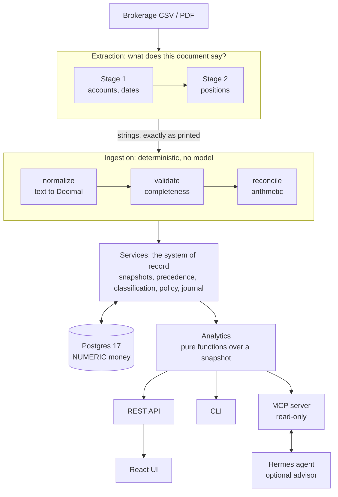

# Hermes Portfolio Manager

**A personal portfolio system of record that uses an LLM to read your brokerage
statements, and refuses to trust it with the arithmetic.**

Drop in a CSV export or a PDF statement from your brokerage. Claude reads it; a
deterministic pipeline checks every number it read; and the result becomes a
dated snapshot of what you actually own. On top of that sit allocation, tax
placement, gains, and drift from your own investment policy, plus an optional
AI advisor that can propose a rebalance but can never change your holdings or
invent a figure.

It runs on your own machine. Your statements and your data stay there.

---

## Why this exists

Anyone with accounts at more than one institution knows the problem. Each
brokerage exports in its own format, and changes it without notice. Fund names
are abbreviated past recognition. `--` means six different kinds of "nothing".
And one institution will happily report accounts held at *another*,
second-hand and weeks out of date, in the same file as its own.

A language model is very good at reading documents like that. It is not
something you should let decide what your net worth is. So this project splits
the job:

| Layer | Answers | Who decides |
|---|---|---|
| **Extraction** | "What does this document say?" | A model (Claude), behind a replaceable interface |
| **Portfolio manager** | "What is true?" | Deterministic code: parsing, validation, reconciliation |
| **Advisor** *(optional)* | "What should I do about it?" | An agent ([Hermes](docs/HERMES_INTEGRATION.md)), read-only |

Everything the model produces passes through validation and arithmetic before it
becomes state, and the model has no influence over that step. The advisor reads
the portfolio but has no way to change it.

## The one idea worth knowing up front

**Every figure travels with what qualifies it.**

A total is never shown alone if part of it is stale, unclassified, or missing a
cost basis. Where a number is unknown, the app says so instead of estimating
one.

That isn't defensiveness. On the real portfolio this was built against, 61% of
the value sat in accounts whose as-of date was unknown, and the aggregation feed
reporting them had missed an entire rebalance. A confident-looking total would
have been wrong in a way nothing on screen revealed.

## Features

### Import anything, lose nothing
- **CSV exports and PDF statements**, read by Claude in two stages: first *which
  accounts does this document contain?*, then *what does each one hold?*
  Built and tested on Fidelity and Vanguard documents;
  [adding an institution](docs/ADDING_AN_INSTITUTION.md) covers the rest.
- **A completeness check no arithmetic can replace.** If an account found in the
  first stage goes missing in the second, the import is held for review, even
  though the numbers that remain reconcile perfectly.
- **Deduplicated by content**, so importing the same file twice does nothing.
- **Originals kept forever** under `data/sources/`, so any reading can be
  re-derived when the extraction improves or a number is disputed.
- **Several documents, one portfolio.** Import an aggregator's export and a
  direct statement together. For each account, the more authoritative source
  wins and supplies it whole; holdings are never patched together from two
  sources of different ages.
- **Nothing silently skipped.** Accounts with no value are named; a failed
  reconciliation is kept and shown for review, never discarded.

### Numbers you can trust
- **Reconciliation, not hope.** Quantity × price against value, cost basis +
  gain against value, holdings + cash against account totals, account totals
  against the portfolio. Tolerances are capped so a large account can't hide a
  real gap inside "rounding".
- **Absence is not zero.** A missing cost basis stays missing, and gains are
  reported for the part of the portfolio that has one.
- **Money is never a float**: `Decimal` in Python, `NUMERIC(20,6)` in Postgres,
  and strings on every wire.
- **Share counts are never summed across accounts**, because the same fund can
  be pre-split in one source and post-split in another. Values add; quantities
  stay per account.

### See where you stand
- **Dashboard** with a value-over-time chart and the caveats that qualify each
  figure: stale value, unconfirmed tax treatment, missing cost basis,
  incomplete imports.
- **Allocation and tax placement.** Accounts whose tax treatment you haven't
  confirmed are left out of tax analysis rather than assumed taxable.
- **Exposure** to a security across every account, **gains**, **cash**, and
  **snapshot comparisons**, reported as a change in value and never dressed up
  as a return.

### Your plan, not the app's
- **An investment policy you write**: target weights, drift bands and
  constraints, in commented YAML. Every save is a new version, so "what was my
  policy when I made that call?" stays answerable.
- **Drift, honestly labelled.** *Out of policy* is a fact about the portfolio;
  *provisional* means the data is too uncertain to act on. A portfolio can be
  in band and still provisional.
- **A recommendation journal** of what was suggested and what you decided.
  Deferring is not rejecting, and decisions append rather than overwrite.

### An AI advisor that can't touch your money *(optional)*
- **Chat with an agent that knows your portfolio.** Tell it your philosophy,
  views and preferences, give it pages or PDFs to weigh, and ask for a
  rebalance. It researches current news and proposes trades per account.
- **The model never produces a number.** Every figure in a proposal (trades,
  resulting allocation, estimated gains, uninvested cash) comes from the app's
  own rebalancing engine. When the advisor saves a proposal, the app re-runs it
  and stores its own result.
- **Dollars, not shares**, and never a transfer between accounts.
- **No targets, no proposal.** With neither a policy nor targets you've agreed
  to, the engine refuses and the advisor has to ask you.

### Built to be scripted and kept
- **A full CLI.** Everything the web UI does works without a browser, which is
  how reconciliation output is easiest to read.
- **An MCP server** with 24 tools so any agent can read the portfolio: read-only
  apart from three advisory writes, each enforced by a test and by
  `SET TRANSACTION READ ONLY`.
- **Docker Compose**, or a macOS login agent that starts it for you.
- **Backup and restore** that keep the database and the original documents
  together, because either one without the other is incomplete.

### What it deliberately does not do
It doesn't trade or move money: nothing the advisor proposes happens unless you
do it yourself. It doesn't fill gaps with assumptions. It isn't investment
advice.

## Architecture



The advisor's chat runs in the React UI and is relayed to Hermes by the API, so
the agent's key never reaches the browser.

| Layer | Lives in | What it is responsible for |
|---|---|---|
| **Extraction** | `extraction/` | A vendor-neutral provider interface, versioned prompts, and a strict schema that carries money as **strings**, exactly as printed. Providers: Claude, a deterministic `mock` for tests, and a stub for a local model. A benchmark scores a provider against documents with known-good readings before it can replace another. |
| **Ingestion** | `ingestion/` | The only place text becomes `Decimal`. Detects the document kind, cleans it, checks completeness, reconciles the arithmetic, and matches accounts across sources. No model output influences any of it. |
| **Services** | `services/` | The system of record: snapshots, which source wins each account, account and security classification, policy versions, the journal, backups. |
| **Analytics** | `analytics/` | Pure functions over a snapshot: allocation, exposure, gains, cash, comparisons, policy drift, and the rebalancing engine. |
| **Interfaces** | `api/`, `cli.py`, `hermes/` | REST for the React UI, a CLI for everything, and an MCP server for agents. All three go through the same services. |
| **Frontend** | `frontend/` | React 19, Tailwind, TanStack Query and Recharts, served by FastAPI from the same origin in production. |

A few decisions shape everything else:

- **Price lives on the position, not the security.** One document can
  legitimately show two prices for the same symbol.
- **A security doesn't need a ticker.** 529 plan portfolios often have none, so
  identity is the symbol when present, otherwise a normalized name.
- **As-of date is per account**, because an aggregation feed's accounts are as
  old as its last sync, not as old as the file.
- **Classification declines rather than guesses.** "Unknown" is a valid,
  frequent and correct answer.

The full picture, with the pipeline end to end, is in
[Architecture](docs/ARCHITECTURE.md) and [Data model](docs/DATA_MODEL.md).

## Quick start

```bash
brew install python@3.12          # macOS; any 3.12+ works
make install                      # venv + dependencies
make dev-db                       # Postgres 17 in Docker, host port 5433
make migrate

portfolio import path/to/export.csv --provider mock
portfolio summary
```

The `mock` provider parses CSVs deterministically and costs nothing. To use
Claude, which you need for PDFs, copy `.env.example` to `.env` and set
`EXTRACTION_PROVIDER=anthropic` and `ANTHROPIC_API_KEY`.

For the web UI:

```bash
make ui-install
make dev                          # API on :8787
make dev-ui                       # UI on :5173, proxying to the API
```

Or run the whole thing in containers:

```bash
docker compose up -d --build      # app on :8787, UI served from the same origin
```

To have it start by itself at login, see
[starting automatically on a Mac](docs/DEPLOYMENT.md#starting-automatically-on-a-mac).
To connect the advisor, see [Hermes integration](docs/HERMES_INTEGRATION.md#setup).

## Documentation

| Document | What it covers |
|---|---|
| [User guide](docs/USER_GUIDE.md) | Importing, reviewing, classifying, policy, the journal, the advisor |
| [Architecture](docs/ARCHITECTURE.md) | How the pieces fit and why they are shaped that way |
| [Data model](docs/DATA_MODEL.md) | The tables, and the constraints that make them trustworthy |
| [GenAI extraction](docs/GENAI_EXTRACTION.md) | The provider boundary, prompts, and the benchmark |
| [Adding a provider](docs/ADDING_A_PROVIDER.md) | Running a local model instead of Claude |
| [Adding an institution](docs/ADDING_AN_INSTITUTION.md) | Supporting a new brokerage |
| [Hermes integration](docs/HERMES_INTEGRATION.md) | The MCP surface, the skill, the advisor, the trigger |
| [Deployment](docs/DEPLOYMENT.md) | Docker, starting at login, volumes, backup and restore |

## Development

```bash
make test lint ui-check benchmark benchmark-check check-secrets
```

About 570 Python tests (unit, plus integration against a real Postgres) and 13
Playwright end-to-end tests. `ruff`, `ruff format`, `mypy --strict`, `tsc` and
`oxlint` all run clean. `benchmark` calls the configured extraction provider,
so with Claude it costs a little money.

**No real financial data lives in this repository.** Test fixtures are
anonymized derivatives of a private corpus. They keep every structural quirk
(missing tickers, `--` sentinels, split-price divergence) and none of the
content. A guard test reads the owner's statements at run time and fails if
any real name, account number, amount or share count appears in a tracked
file.

## License

Copyright © 2026 Jerry Liu.

Released under the [GNU Affero General Public License v3.0](LICENSE)
(`AGPL-3.0-only`).

In short: you're free to use, study, modify and share this software,
including for commercial purposes. If you distribute a modified version, or
run one as a service that other people use over a network, you must make your
complete source code available to them under the same license. Running it
unmodified, or modifying it for your own private use, carries no such
obligation.

This summary is for convenience; the [license text](LICENSE) is what applies.
